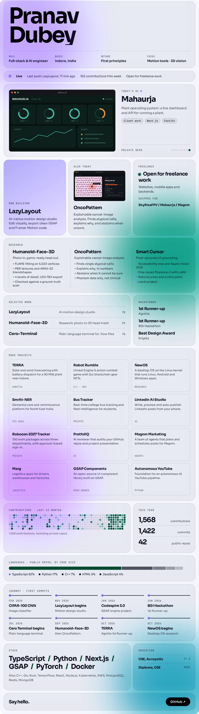

<a href="https://github.com/NetPranav"><picture><source media="(prefers-color-scheme: dark)" srcset="./generated/daily/2026-11-12-aurora-dark.webp"></picture></a>

**Today** Mahaurja · **Also today** [OncoPattern](https://github.com/NetPranav/Cancer-classification-) · **Design** Aurora glass · [All repositories](https://github.com/NetPranav?tab=repositories)

Projects, as text

- [Humanoid-Face-3D](https://github.com/NetPranav/Humanoid-Face-3D): Photo in, game-ready head out.
- [OncoPattern](https://github.com/NetPranav/Cancer-classification-): Explainable cancer image analysis.
- Smart Cursor: Pixel-accurate UI grounding.
- [TERRA](https://github.com/NetPranav/AGNITIA-TERRA06): Solar and wind forecasting with battery dispatch for a 90 MW plant near Indore.
- [Robot Rumble](https://github.com/NetPranav/Game-Development-): Unreal Engine 5 action combat game with Sui blockchain gear NFTs.
- NewOS: A desktop OS on the Linux kernel that runs Linux, Android and Windows apps.
- [Smriti-NER](https://github.com/NetPranav/SIH003): Dementia care and reminiscence platform for North East India.
- Bus Tracker: Real-time college bus tracking and fleet intelligence for students.
- [LinkedIn AI Studio](https://github.com/NetPranav/Automatic-Linkedin-Bot-): Write, preview and auto-publish LinkedIn posts from your phone.
- Robocon 2027 Tracker: 100 work packages across three departments, with approval-based sign-in.
- ProtfoliQ: AI reviewer that audits your GitHub repos and project presentation.
- [Magnm Marketing](https://github.com/NetPranav/Magnm-Marketing): A team of agents that plans and schedules posts for Magnm.
- [Marg](https://github.com/NetPranav/Marg-Application): Logistics apps for drivers, warehouses and factories.
- [GSAP Components](https://github.com/NetPranav/Gsap-Components): An open-source UI component library built on GSAP.
- [Autonomous YouTube](https://github.com/NetPranav/Auto-Youtbe-App): Foundation for an autonomous AI YouTube pipeline.

